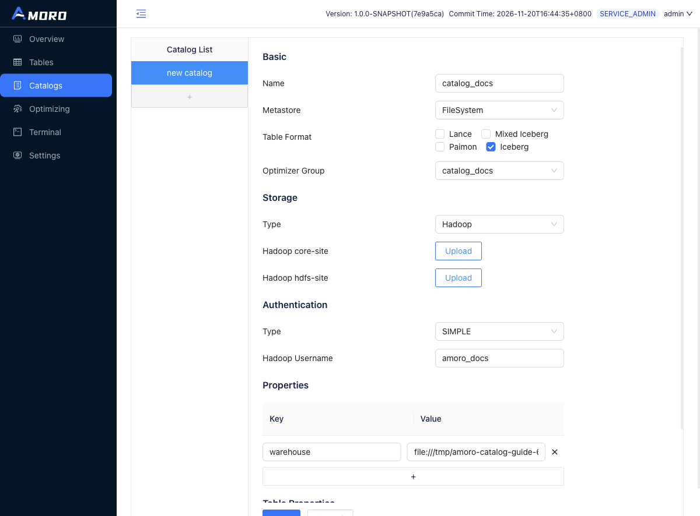
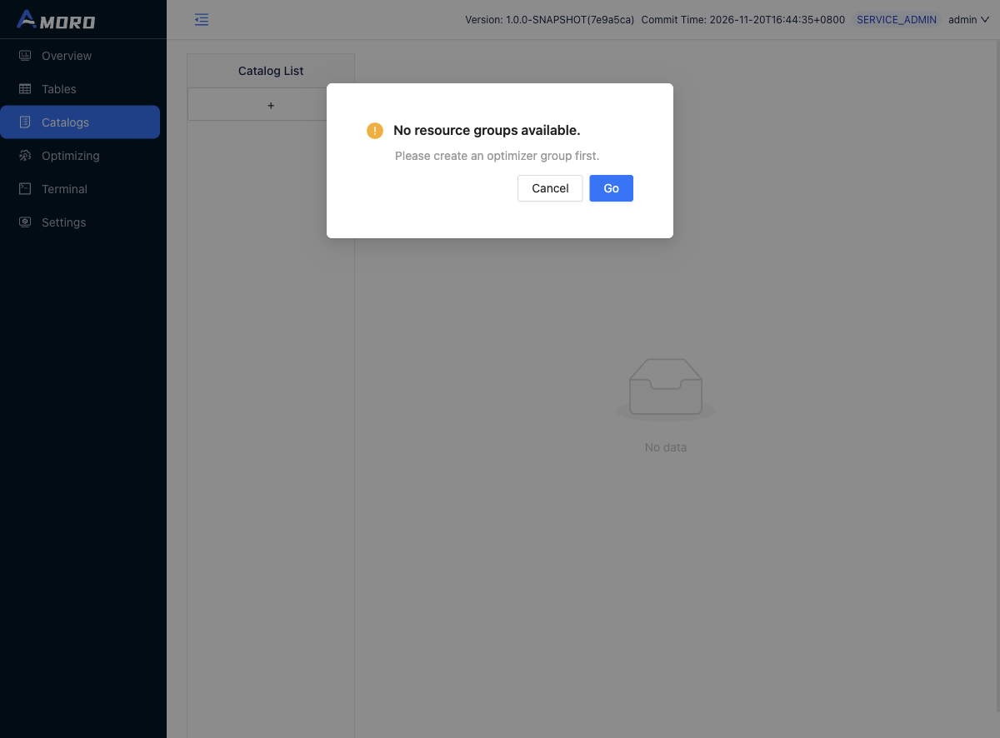
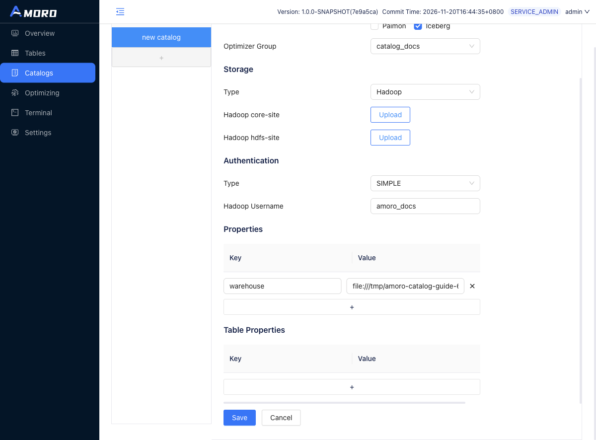
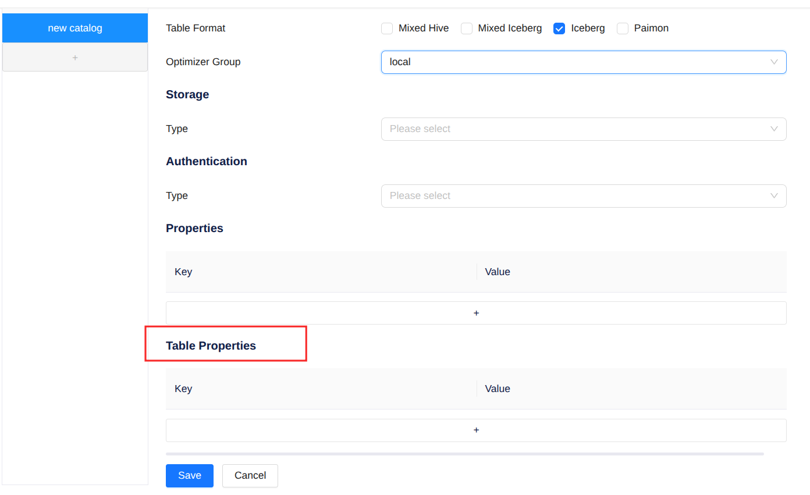
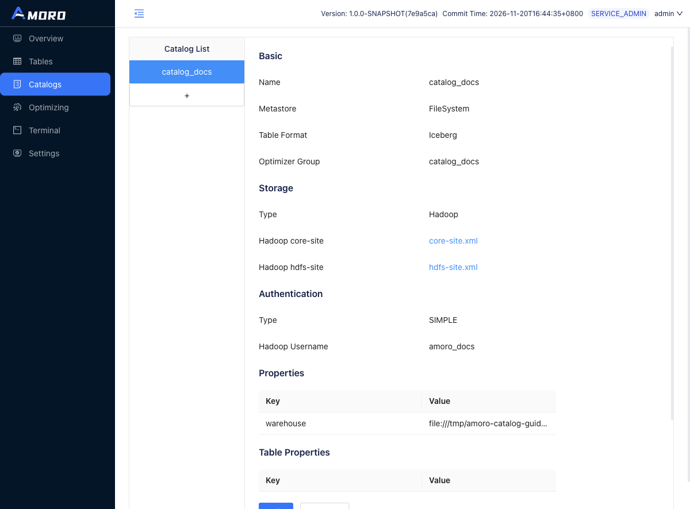
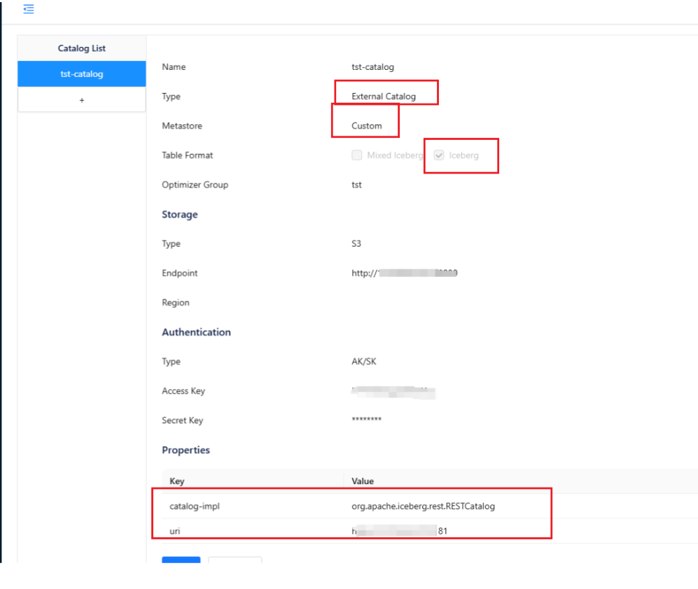
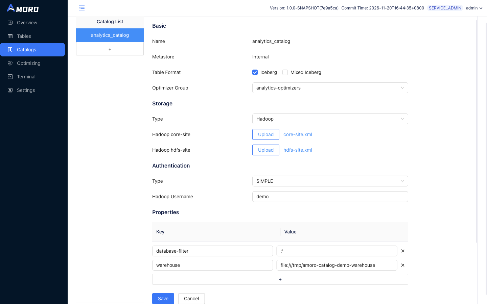

<!--
 - Licensed to the Apache Software Foundation (ASF) under one or more
 - contributor license agreements.  See the NOTICE file distributed with
 - this work for additional information regarding copyright ownership.
 - The ASF licenses this file to You under the Apache License, Version 2.0
 - (the "License"); you may not use this file except in compliance with
 - the License.  You may obtain a copy of the License at
 -
 -   http://www.apache.org/licenses/LICENSE-2.0
 -
 - Unless required by applicable law or agreed to in writing, software
 - distributed under the License is distributed on an "AS IS" BASIS,
 - WITHOUT WARRANTIES OR CONDITIONS OF ANY KIND, either express or implied.
 - See the License for the specific language governing permissions and
 - limitations under the License.
 -->
# Managing Catalogs

Users can import your test or online clusters through the catalog management function provided by the AMS Dashboard. Before adding a new Catalog,
please read the following guidelines and select the appropriate creation according to your actual needs.

## Create catalog

In Amoro, a catalog is a namespace that groups databases and tables. A table is uniquely identified by `catalog.database.table`. A catalog typically corresponds to a metadata service, such as Hive Metastore or the AMS itself.

Before creating a catalog, ensure an optimizer group exists. With role-based authorization, creating a catalog requires the `MANAGE_CATALOG` privilege.

Open **Catalogs** in the sidebar. On the **Catalog List**, click **+** to open the create form.

For example, enter `catalog_docs` as **Name**, choose **FileSystem** as
**Metastore**, leave only **Iceberg** selected under **Table Format**, and
select an existing **Optimizer Group**.

### Configure basic information

- **Name**: catalog name. Only letters, digits, underscores, and hyphens are supported. It must start with a letter (lowercase recommended).
- **Metastore**: metadata storage backend. Options are **Internal**, **Hive**, **FileSystem**, **Glue**, **REST**, and **Custom**. See [Formats Overview](../formats-overview/) for supported combinations.
- **Table Format**: table formats supported under this catalog. Select one or more. When you change the metastore, the default selection may include multiple formats; clear formats you don't need.
- **Optimizer Group**: group used for self-optimizing tables in this catalog. If no optimizer group exists, the dialog shows “No resource groups available. Please create an optimizer group first.” Click **Go** to navigate to **Optimizing** > **Optimizer Groups**. See [Managing Optimizers](../managing-optimizers/) for instructions.

### Configure storage

Storage options depend on the selected metastore and table formats. For **FileSystem** with only **Iceberg** selected, choose **Hadoop** as the storage type.

- **Type**: storage type. Options include **Hadoop**, **S3**, **OSS**, and others depending on metastore and table formats.
- **Hadoop core-site** and **Hadoop hdfs-site**: XML configuration files for the Hadoop cluster. Upload them if you need to access a cluster; for a local demo, you can leave both empty. Use actual cluster files when connecting to a cluster.
- **Hadoop hive-site**: XML configuration file for Hive Metastore, shown when applicable.
- **Endpoint** and, where available, **Region**: connection settings for object storage.

### Configure authentication

Authentication options depend on storage type. For **Hadoop** storage, choose **SIMPLE** or **KERBEROS**.

- **Type**: authentication method. For Hadoop, **SIMPLE** or **KERBEROS**.
- **Hadoop Username**: required for **SIMPLE**.
- **Principal**, **Keytab**, **krb5**: fields and file uploads for **KERBEROS**.
- Other storage types (e.g., S3, OSS) show different authentication fields such as **Access Key** and **Secret Key**.

### Configure properties

In the **Properties** section, add catalog-level key-value properties. For this local example, set `warehouse` to an absolute file URI such as
`file:///tmp/amoro-catalog-guide/warehouse`, and use **SIMPLE** authentication
with a **Hadoop Username**, such as `amoro_docs`. The screenshots use a
disposable local directory.

A local file URI is suitable for a single-host demo. In a deployed environment,
use a warehouse URI that AMS and the relevant engines and optimizers can access
with the configured credentials.

Common properties include:

- `warehouse`: required for Internal, FileSystem, and Glue catalogs. Determines where database and table files are placed.
- `catalog-impl`: required for **Custom** metastore. Put the custom catalog implementation jar in `{AMORO_HOME}/lib` and restart the service.
- `clients`: Hive Metastore connection pool size. Default is 20. Requires restarting Amoro to take effect.
- `database-filter` matches a regular expression against the full database name.
  For example, `analytics` shows only the `analytics` database.
- `table-filter` matches a regular expression against the full `database.table`
  name. For example, `analytics[.]events` shows only the `events` table in
  the `analytics` database.

These filters apply to the AMS database and table lists for external catalogs.
Internal catalogs display unfiltered lists. Leave a filter unset to list all
entries of that kind in an external catalog.

### Configure table properties
In the web UI for creating a catalog, there are two properties fields that serve different purposes:
- **Properties** adds catalog-level properties.
- **Table Properties** adds catalog-level table properties.

To apply the same table property to every table under a catalog, add it through the **Table Properties** field.

#### Adding table-level properties through the Properties field

If you add table-level properties through the **Properties** field instead, you must prefix the key with `table.`. For example, to set the default `self-optimizing.group` for all tables under a catalog, you need to configure `table.self-optimizing.group` instead of `self-optimizing.group`. Keys without the `table.` prefix are not recognized as table-level defaults and are treated as catalog-level properties only.


For the full list of available table properties, see [Table configurations](../configurations/).

### Save and verify

After filling in the required fields, click **Save**. The catalog is created and the form switches to a read-only detail view showing the saved configuration.

In the **Catalog List**, the new catalog appears by name. To verify persistence, open **Catalogs** in the sidebar and check the list, or click the catalog to reopen its detail page.

The screenshots show the English dashboard in `1.0.0-SNAPSHOT` at commit `7e9a5ca`.

## REST Catalog
When a user needs to create a Iceberg REST Catalog, they can choose **External Catalog Type**、**Custom Metastore Type**、**Iceberg Table Format**, configure properties include:
**catalog-impl=org.apache.iceberg.rest.RESTCatalog**, **uri=$restCatalog_uri**.

After configuring the above parameters, the final result in the AMS frontend will look like this:

### Nessie's REST Catalog
When a user needs to create a Nessie Rest Catalog, they can also set **catalog-impl=org.apache.iceberg.nessie.NessieCatalog** on top of the above parameters.

## Edit a catalog

In the AMS Dashboard, open **Catalogs**, select a catalog from the **Catalog List**,
and click **Edit**. The **Name** and **Metastore** fields are read-only for an
existing catalog. The available table formats and storage options depend on the
metastore.

To change the catalog's default optimizer group, choose an existing group in
**Optimizer Group**. Click **Save** to apply the change. Click **Cancel** to
discard unsaved changes and return to the saved configuration.

### Select tables for a table filter

When editing an existing catalog, add a property whose key is exactly
`table-filter`. Click the selected-table count below its value to open the table
selector.

- Search for a database on the left, then select its tables on the right.
- Both lists can be searched. **Select all visible tables** selects or deselects
  editable tables in the current database's search results only.
- Switch databases to select or deselect tables across multiple databases before
  clicking **Confirm**. Selections are retained while switching databases.
- **Confirm** updates the property text; click **Save** on the catalog page to
  persist it. **Cancel** in the selector leaves the property text unchanged.

Existing exact rules such as `(analytics\\.events)|(other\\.users)` are recognized
and can be removed individually. Newly selected table names are escaped as exact
Java regular expressions and deduplicated. Existing custom regular expressions
are preserved. Tables matched by a saved custom expression, for example
`analytics\\.events_.*`, appear checked and disabled; edit the expression itself
to change that coverage. The selector uses server-side Java regex matching, not
JavaScript regex matching.

The selector lists catalog databases and tables without applying
`database-filter` or `table-filter`; it still uses the catalog's configured
credentials and selected table formats. This does not change the filters used
by normal catalog operations. The selector is available after a catalog has
been created. When creating a new catalog, enter the filter as text.

Matching of custom expressions currently uses the saved catalog property.
After editing a custom expression as text, save the catalog before reopening
the selector to refresh its matched-table state. The selected-table count
includes custom-expression matches after the selector has loaded.

## Delete catalog
When a user needs to delete a Catalog, they can go to the details page of the Catalog and click the Remove button at the bottom of the page to perform the deletion.


Before deleting an internal catalog, AMS will verify whether there is metadata for tables under that Catalog.
If there are still tables under that Catalog, AMS will prompt that the deletion failed.

